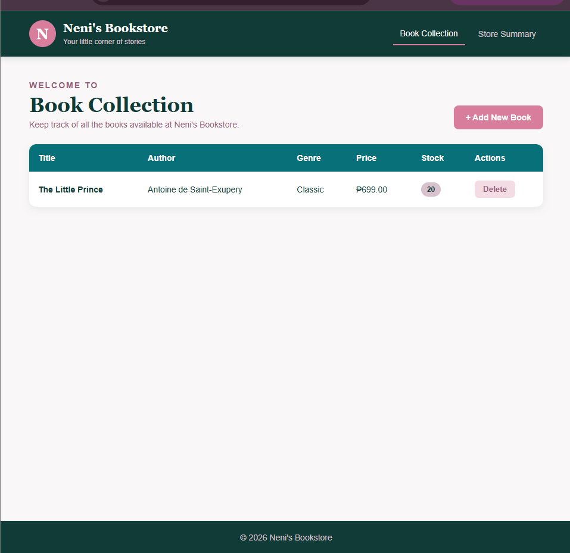
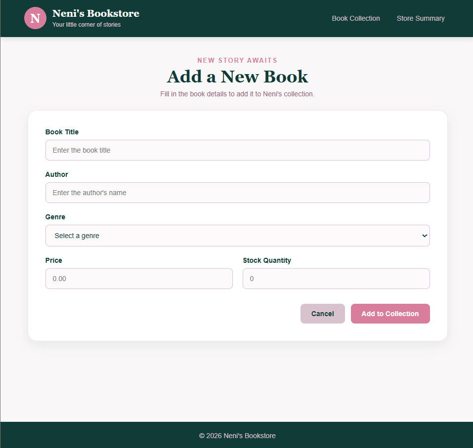
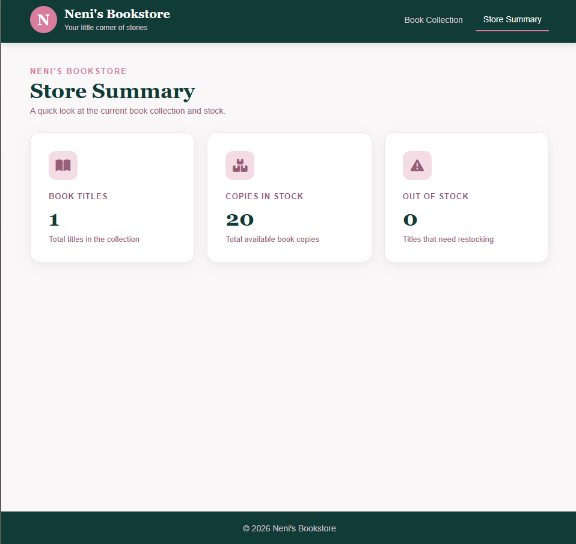

# Neni's Bookstore

A simple bookstore catalog management system developed as an academic project for Web Systems and Technologies 2 (IT 402).

## About the Project

Neni's Bookstore is a web-based application designed to help organize book information and monitor stock availability. It allows users to manage book records and view a summary of the bookstore's inventory.

## Features

- View the book collection
- Add books with title, author, genre, price, and stock quantity
- Validate book information before saving
- Delete book records with confirmation
- View store summary statistics, including total titles, total stock, and out-of-stock books

## Technologies Used

- PHP and Laravel
- Laravel Blade
- MySQL
- HTML, CSS, and JavaScript
- Laragon (local development)

## Project Information

**Project Type:** Academic Activity  
**Course:** Web Systems and Technologies 2 (IT 402)  
**Academic Year:** 2026–2027

## Project Note

This project was developed for educational purposes to practice Laravel development, database operations, form validation, and basic inventory management.

## Application Screenshots

### Book Collection

### Add New Book

### Store Summary

